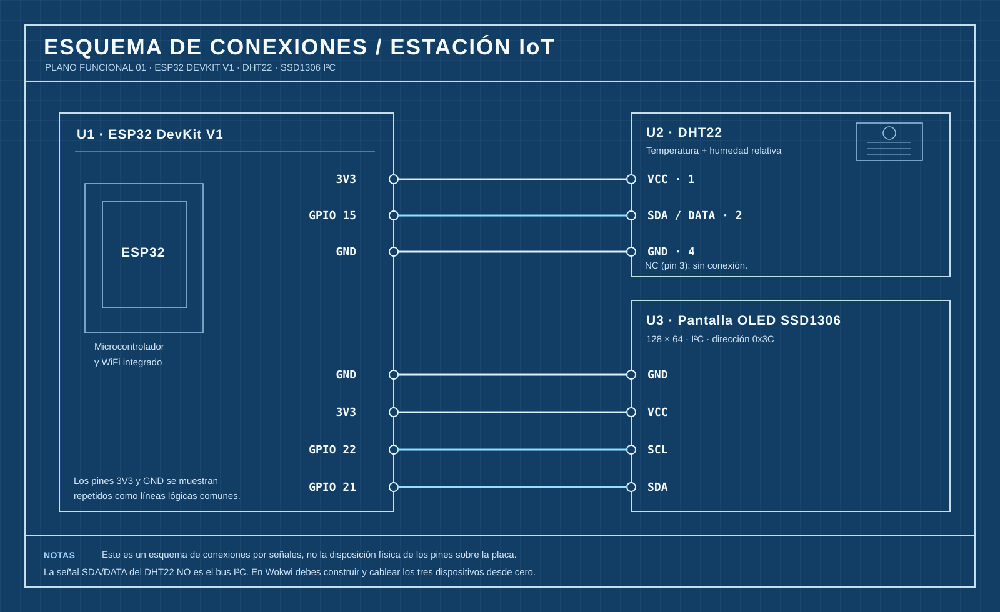

# Laboratorio 2 — Estación IoT: ESP32, Wokwi y API Flask

**Componentes y servicios:** ESP32 · DHT22 · Pantalla OLED SSD1306 · Python/Flask · GitHub · Render.

## Propósito y resultado esperado

Construya una estación simulada en Wokwi que obtenga **una lectura inicial** de temperatura y humedad desde un sensor DHT22. A partir de esa lectura, el programa calculará **24 horas de datos sintéticos**, mostrará las mediciones en una OLED y las transmitirá juntas a una API Flask mediante una solicitud HTTP `POST`. Finalmente, consulte y descargue las mediciones recibidas desde su servidor desplegado en Render.

**Recorrido del ejercicio:** `DHT22 → simular 24 horas → OLED + lote JSON → POST → Flask/Render → GET → descarga`.



El repositorio incluye **cinco archivos**:

| Archivo | Para qué sirve | Qué debe realizar usted |
|---|---|---|
| `README.md` | Guía de trabajo | Seguir el procedimiento |
| `plano.svg` | Plano del circuito | Construir las conexiones en Wokwi |
| `app.py` | Código inicial de la API | Completar dos endpoints sencillos |
| `sketch.ino` | Firmware con funciones de apoyo | Completar la receta de cuatro pasos en `setup()` |
| `.gitignore` | Ignora archivos locales | No requiere modificación |

**No se proporciona `diagram.json` ni `libraries.txt`:** debe agregar los componentes, conectarlos e identificar las bibliotecas de Arduino utilizadas. El firmware incluye las funciones técnicas de apoyo que no necesita modificar.

---

## 1. Prepare Python y su repositorio GitHub

**1.1. Compruebe las herramientas.** Utilice Python 3, Git, una cuenta de GitHub, una cuenta de Render y acceso a [Wokwi](https://wokwi.com). Puede usar Visual Studio Code.

```bash
python --version
git --version
```

En Windows, si `python` no está disponible, utilice `py --version`.

**1.2. Cree su repositorio.** Desde el repositorio de la actividad, pulse **Use this template → Create a new repository**. Seleccione un nombre para su copia y clónela:

```bash
git clone URL_DE_SU_REPOSITORIO
cd NOMBRE_DEL_REPOSITORIO
```

**1.3. Prepare el entorno e instale Flask.** Ejecute en la carpeta clonada:

*Windows — PowerShell:*

```powershell
py -m venv .venv
.\.venv\Scripts\python.exe -m pip install flask
```

*Linux/macOS:*

```bash
python3 -m venv .venv
.venv/bin/python -m pip install flask
```

`venv` aísla las bibliotecas instaladas para este ejercicio. El directorio `.venv` no debe subirse a GitHub.

---

## 2. Complete Python siguiendo el orden de `app.py`

Una API recibe solicitudes en **rutas** o *endpoints*. En este laboratorio se usarán:

| Ruta | Método | Función |
|---|---|---|
| `/salud` | GET | Comprobar que la API funciona (ya entregada) |
| `/mediciones` | GET | Consultar las mediciones (por implementar) |
| `/mediciones` | POST | Recibir y guardar mediciones (por completar) |
| `/descargar` | GET | Descargar los datos (ya entregada) |

**2.1. Observe el ejemplo disponible.** En `app.py` se incluye:

```python
@app.get("/salud")
def salud():
    return jsonify({"estado": "ok"}), 200
```

Lectura línea por línea: `@app.get` asocia la dirección `/salud` con la función `salud()`. El `return` entrega un JSON y el código HTTP `200` (solicitud exitosa).

**2.2. Programe GET `/mediciones`.** Escriba su decorador, su función y su respuesta siguiendo el ejemplo anterior. En vez de devolver un mensaje fijo, debe devolver la lista global `mediciones`.

**2.3. Programe POST `/mediciones`.** Una solicitud `POST` trae información en el cuerpo. La primera línea ya incluida en la función:

```python
cuerpo = request.get_json(silent=True)
```

convierte el JSON recibido en un diccionario de Python. El programa comprueba que existan las claves `dispositivo` y `mediciones`. Complete el paso restante: recorra `cuerpo["mediciones"]`, añada a cada registro el identificador de dispositivo y guarde el registro en la lista `mediciones`. La respuesta debe incluir cuántas mediciones llegaron y el código HTTP `201` (recurso creado).

**Expresiones que puede utilizar:**

| Python | Qué significa | Ejemplo breve |
|---|---|---|
| `def nombre():` | Declarar una función | `def consultar():` |
| `@app.get("/ruta")` | Crear endpoint GET | `@app.get("/mediciones")` |
| `return jsonify(lista), 200` | Responder en JSON | `return jsonify(mediciones), 200` |
| `cuerpo["mediciones"]` | Acceder a una clave del JSON recibido | Obtener los registros |
| `for registro in lista:` | Recorrer una lista | `for registro in cuerpo["mediciones"]:` |
| `registro["dispositivo"] = ...` | Agregar un campo | Incorporar el ID recibido |
| `mediciones.append(registro)` | Guardar al final de la lista | Conservar un registro |
| `len(lista)` | Contar elementos | `len(cuerpo["mediciones"])` |

**2.4. Pruebe Flask en su computador.** Inicie el servidor:

*Windows:*

```powershell
.\.venv\Scripts\python.exe app.py
```

*Linux/macOS:*

```bash
.venv/bin/python app.py
```

Abra `http://127.0.0.1:5000/salud` y `http://127.0.0.1:5000/mediciones`. Si su GET está bien, verá inicialmente `[]`, es decir, una lista vacía.

Para probar `POST` antes de usar Wokwi, abra **otra ventana de PowerShell**:

```powershell
$datos = '{"dispositivo":"doctorado-01","mediciones":[{"hora_simulada":"12:00","temperatura":24.2,"humedad":54.0}]}'
Invoke-RestMethod -Uri 'http://127.0.0.1:5000/mediciones' -Method Post -ContentType 'application/json' -Body $datos
```

Al repetir GET `/mediciones`, debe aparecer el registro de la prueba. Si el servidor responde `501`, aún falta completar el código del POST.

---

## 3. Guarde Python en GitHub y despliegue en Render

Render descargará el **código del repositorio de GitHub**, no el archivo que tiene abierto en su computador. Por ello, guarde y suba `app.py` antes de realizar el despliegue:

```bash
git status
git add app.py
git commit -m "Implementar API Flask"
git push
```

1. Ingrese en [Render](https://dashboard.render.com) y seleccione **New → Web Service**.
2. Conecte GitHub y seleccione su repositorio y rama `main` (o su rama principal).
3. Configure lo siguiente:

| Campo | Valor |
|---|---|
| Language | `Python 3` |
| Root Directory | Dejar vacío |
| Build Command | `pip install flask gunicorn` |
| Start Command | `gunicorn app:app --bind 0.0.0.0:$PORT --workers 1` |
| Instance Type | `Free`, si está disponible |

4. Publique el servicio y copie su URL pública `https://SU-SERVICIO.onrender.com`.
5. Compruebe `https://SU-SERVICIO.onrender.com/salud` y `https://SU-SERVICIO.onrender.com/mediciones`.

**Importante:** los registros quedan en la memoria temporal del servidor, no en una base de datos. Un reinicio o suspensión de Render puede borrarlos. Descargue los datos al finalizar la práctica.

---

## 4. Construya el circuito en Wokwi

1. Abra [un proyecto nuevo ESP32](https://wokwi.com/projects/new/esp32).
2. Añada **DHT22** y **OLED SSD1306 (I²C)**.
3. Realice las conexiones de `plano.svg`:

| Componente | Pin de componente | ESP32 |
|---|---|---|
| DHT22 | VCC | 3V3 |
| DHT22 | GND | GND |
| DHT22 | SDA / DATA | GPIO 15 |
| OLED | VCC | 3V3 |
| OLED | GND | GND |
| OLED | SDA | GPIO 21 |
| OLED | SCL | GPIO 22 |

El pin NC del DHT22 permanece sin conexión.

4. Copie `sketch.ino` al proyecto. Las líneas `#include <...>` indican las bibliotecas utilizadas. Investigue e instale las que falten desde el **Library Manager** de Wokwi.
5. Modifique la constante `API_URL` y reemplace `SU-SERVICIO` por su dominio Render. Mantenga `/mediciones` al final.

---

## 5. Comprenda las funciones de apoyo antes de programar

Abra `sketch.ino`. En la parte superior encontrará las constantes y objetos. Después verá la **RECETA PRINCIPAL** en `setup()`: ese es el lugar donde debe completar los pasos. Las funciones de apoyo aparecen **al final** del archivo; ya están desarrolladas y no es necesario modificarlas.

### 5.1. ¿Por qué todo ocurre en `setup()`?

En Arduino, `setup()` se ejecuta **una sola vez** cuando se inicia la simulación; `loop()` se repite continuamente. En este ejercicio necesitamos **enviar un solo día de mediciones una sola vez**, por eso se organiza el procedimiento dentro de `setup()` y se deja `loop()` sin nuevas operaciones.

### 5.2. ¿Qué hace cada función entregada?

| Función | Qué recibe | Qué realiza |
|---|---|---|
| `simularHora(hora, tempBase, humBase)` | Número de hora y temperatura/humedad iniciales | Calcula una medición sintética y devuelve sus tres campos |
| `mostrarEnPantalla(hora, temp, hum)` | Una medición | Escribe sus valores en la OLED |
| `iniciarLote()` | Nada | **Vacía el lote anterior** y comienza un JSON nuevo |
| `agregarMedicion(hora, temp, hum)` | Una medición | La convierte a JSON y la agrega al lote actual |
| `enviarLote()` | Nada | **Cierra** el JSON y lo transmite mediante un `POST` |

El archivo contiene también `convertirAJSON()`, una función **interna** que utiliza `agregarMedicion()` para producir el texto JSON de una hora. **Usted no debe llamarla ni escribir JSON manualmente.**

### 5.3. ¿Por qué `iniciarLote()` se llama ANTES del `for`?

Un **lote** es un conjunto de registros que se enviarán juntos. `iniciarLote()` prepara un recipiente vacío. Cada `agregarMedicion()` añade un registro dentro de ese mismo recipiente. Finalmente, `enviarLote()` lo cierra y transmite su contenido.

Observe la evolución del lote (valores solo ilustrativos):

**Antes del ciclo:**

```cpp
iniciarLote();
```

La función deja abierta una estructura equivalente a:

```json
{"dispositivo":"doctorado-01","origen":"simulacion_dia","mediciones":[
```

Este fragmento **todavía no es un JSON completo**: falta añadir las mediciones y cerrar `]}`.

**En la primera vuelta del `for` (hora 0):**

```cpp
agregarMedicion(0, 22.5, 60.0);
```

Se incorpora el primer objeto: `{"hora_simulada":"00:00","temperatura":22.5,"humedad":60.0}`.

**En las siguientes vueltas (horas 1 a 23):** cada llamada agrega otra medición al **mismo lote**, separando correctamente los registros.

**Después del `for`:**

```cpp
enviarLote();
```

La función cierra el arreglo y el objeto JSON (los caracteres `]}`), y transmite **un solo POST que contiene 24 mediciones**.

**Si colocara `iniciarLote()` dentro del `for`, borraría los registros anteriores en cada iteración.** Al final solo conservaría la última hora. Asimismo, si llamara `enviarLote()` dentro del `for`, intentaría enviar lotes incompletos o repetidos. Por eso el orden es fundamental.

### 5.4. ¿Cómo se utiliza `simularHora()`?

El sensor entrega **una temperatura y una humedad iniciales**. `simularHora()` toma esos valores como base y calcula datos distintos para una hora indicada:

```cpp
Medicion dato = simularHora(12, 24.0, 50.0);
```

El resultado se guarda en la variable `dato`. Acceda a sus valores mediante:

```cpp
dato.hora
dato.temperatura
dato.humedad
```

`Medicion` es un tipo de dato entregado que agrupa esos tres valores. No necesita modificar su definición.

### 5.5. Palabras clave de Arduino para la receta

| Expresión | Para qué sirve |
|---|---|
| `TempAndHumidity lectura = sensor.getTempAndHumidity();` | Leer una vez DHT22 (temperatura y humedad iniciales) |
| `lectura.temperature` / `lectura.humidity` | Obtener cada valor de la lectura |
| `isnan(valor)` | Comprobar si el sensor entregó un número inválido |
| `if (condicion) { ... }` | Ejecutar una acción si se cumple una condición |
| `return;` | Terminar la función actual si no se puede continuar |
| `for (int hora = 0; hora < 24; hora++)` | Repetir una operación para cada hora de 0 a 23 |
| `Medicion dato = simularHora(...)` | Obtener los valores simulados de la hora |
| `Serial.println(valor)` | Mostrar un valor en el monitor serie |
| `delay(200)` | Mantener la hora visible brevemente en la pantalla |

---

## 6. Complete la receta del ESP32

En `sketch.ino`, busque el bloque **RECETA PRINCIPAL: TRABAJE AQUÍ**. El sensor, la pantalla y WiFi ya tienen su inicialización preparada. Complete únicamente estas cuatro acciones, en el orden señalado:

**Paso 1 — Leer:** obtenga `lectura` desde DHT22. Si alguno de sus dos valores es inválido, informe por el monitor serie y termine `setup()`.

**Paso 2 — Iniciar:** llame **una vez** a `iniciarLote()`. En este momento aún no hay horas simuladas.

**Paso 3 — Repetir 24 veces:** cree un `for` desde la hora `0` hasta la `23`. En cada vuelta:

- Obtenga `dato` llamando a `simularHora()` con la hora y los valores iniciales del sensor.
- Muestre `dato` con `mostrarEnPantalla()`.
- Incorpore `dato` al lote mediante `agregarMedicion()`.

**Paso 4 — Enviar:** una vez **terminado el ciclo**, llame a `enviarLote()` e imprima el código HTTP recibido. La respuesta esperada de su API es `201`.

La receta completa tiene este orden lógico (esquema, no código que deba copiar literalmente):

```text
INICIAR SENSOR, PANTALLA Y WIFI          [YA ENTREGADO]
LEER temperaturaBase y humedadBase       [POR COMPLETAR]
INICIAR LOTE VACIO                       [POR COMPLETAR]
PARA hora = 0 hasta 23                   [POR COMPLETAR]
    SIMULAR una hora
    MOSTRAR esa hora en OLED
    AGREGAR esa hora al lote
FIN PARA
ENVIAR el lote con un solo POST        [POR COMPLETAR]
```

No necesita modificar las funciones que están debajo de `// FUNCIONES DE APOYO ENTREGADAS`.

---

## 7. Ejecute la simulación y verifique la recepción

1. Compruebe primero que `https://SU-SERVICIO.onrender.com/salud` responde correctamente. Si su servicio gratuito estaba suspendido, espere a que vuelva a estar disponible antes del envío.
2. Inicie Wokwi y abra el **Serial Monitor**.
3. Observe las 24 horas simuladas en la pantalla. La pantalla muestra una hora a la vez.
4. Al finalizar, el monitor serie debe indicar aproximadamente:

```text
Conectando WiFi...
WiFi conectado
Registros enviados: 24
HTTP: 201
Codigo HTTP final: 201
```

5. Abra `https://SU-SERVICIO.onrender.com/mediciones`: deben aparecer 24 registros por cada simulación completa. Si previamente probó el POST local o en Render, podrá ver más registros.
6. Abra `https://SU-SERVICIO.onrender.com/descargar` y guarde el archivo `mediciones.json`.

**Comprobación del JSON obtenido:** cada objeto debe incluir `hora_simulada`, `temperatura`, `humedad` y `dispositivo`. Los valores serán calculados a partir de la lectura inicial del DHT22.

Si necesita aislar un problema de conexión HTTP, puede colocar temporalmente una URL de [Webhook.site](https://webhook.site) en `API_URL` y observar el cuerpo del POST. Luego vuelva a configurar la URL de Render.

---

## 8. Conserve su circuito y su código en GitHub

El repositorio de partida **no incluía el circuito construido**. Una vez que funcione, conserve también su trabajo de Wokwi:

1. Guarde o exporte el contenido del editor de circuitos como **`diagram.json`**.
2. Guarde el archivo **`libraries.txt`** generado por las bibliotecas que usted instaló en Wokwi.
3. Sustituya `sketch.ino` por su versión final.
4. Copie esos archivos a la carpeta de su repositorio, junto con `app.py`.
5. Ejecute:

```bash
git status
git add app.py sketch.ino diagram.json libraries.txt
git commit -m "Completar circuito y envio IoT"
git push
```

**Resultado verificable:** su repositorio contiene el circuito y el código; su API en Render responde a GET y POST; el navegador permite descargar las 24 mediciones.

## Observaciones y referencias

La API usa memoria temporal; no representa un almacenamiento persistente. Para esta demostración con datos sintéticos, el firmware omite la verificación del certificado HTTPS; **no debe utilizarse así para información confidencial ni en producción**.

[Flask, inicio rápido](https://flask.palletsprojects.com/en/stable/quickstart/) · [Render, despliegue Flask](https://render.com/docs/deploy-flask) · [Wokwi, conexión WiFi ESP32](https://docs.wokwi.com/guides/esp32-wifi) · [Wokwi, DHT22](https://docs.wokwi.com/parts/wokwi-dht22) · [Wokwi, OLED SSD1306](https://docs.wokwi.com/parts/board-ssd1306)
